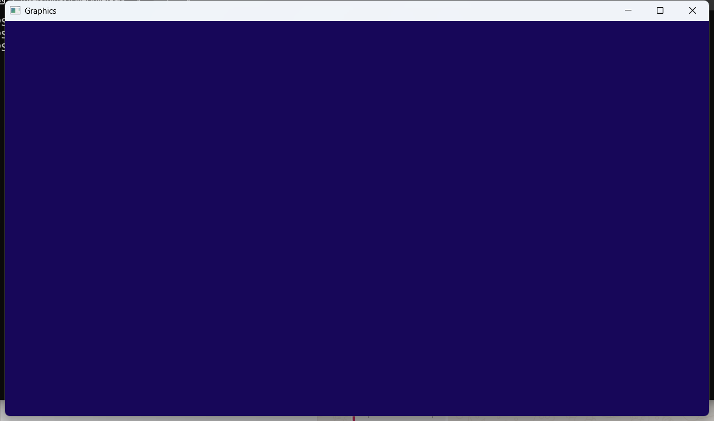
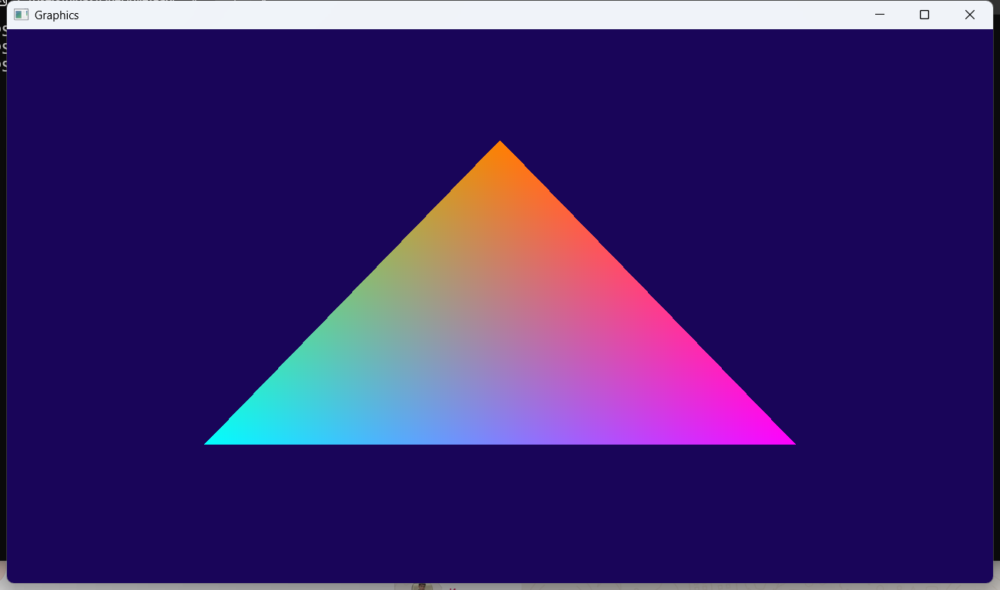

# Computer Graphics (OpenGL 3.3, GLFW, GLAD)

| Папка | Задание |
|---|---|
| `week01` | Окно, цикл рендера, анимированный `glClearColor`, Space — белый фон, счётчик FPS |
| `week02` | Цветной треугольник: VAO/VBO, шейдеры строками в коде |
| `week03` | Шейдеры загружаются из файлов `vertex.glsl` / `fragment.glsl` |

## Сборка (MinGW-w64, Windows)

```
build.bat week03
cd week03
main.exe
```

Запускать нужно из папки недели (там лежат шейдеры и `glfw3.dll`). Esc — выход.

## Результаты

**week01** — окно с анимированным фоном  


**week02** — цветной треугольник  


**week03** — то же, шейдеры из файлов  

