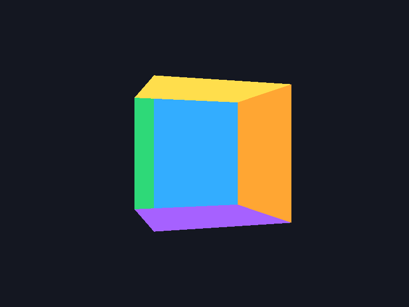
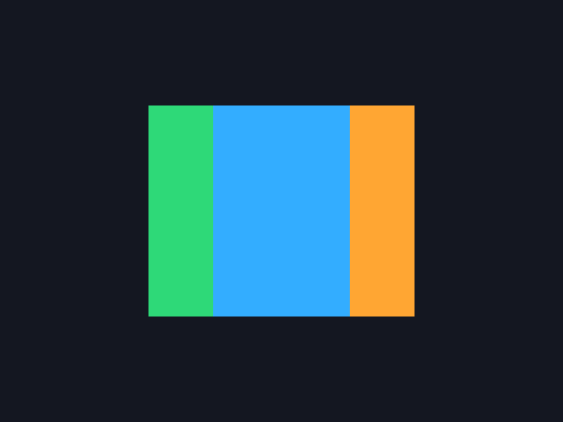

# 7-апта. Координаттар кеңістігі, MVP және проекция

`week07.exe` файлын іске қос. Куб Y осінен айналады. Тереңдік тесті 8-аптада қосылады, сондықтан кей сәтте алыс бет жақын бетті жауып қалады.

- **F** — FOV мәндерін ауыстыру. 30°-та куб үлкен, 45° — бастапқы көрініс, 90°-та куб кішірек, 120°-та одан да кішірек. Көру бұрышы өскенде экранға кеңірек аймақ сыяды.
- **N** — near. 0.1 және 1.0 кезінде куб толық сыяды. 2.5 кезінде айналып тұрған кубтың ең жақын бұрыштары қиылады. 4.0 кезінде куб толығымен қиылады, өйткені ең алыс төбесі де камерадан 4 бірлікке жетпейді.
- **B** — far. 100 және 5 кезінде бір куб толық сыяды. 2 кезінде куб түгелдей алыс қию жазықтығынан тыс қалады. near ≥ far комбинациясы жарамсыз. Мысалы, near 2.5 және far 2 кезінде экран бос болады.
- **O** — перспектива мен ортография. Перспективада жақын қырлар ірілеу көрінеді. Ортографияда параллель қырлар параллель болып қалады, масштаб тереңдікке тәуелсіз, clip-space w = 1.
- **1 / 3** — бір немесе үш куб. Үш куб бір VAO пайдаланады, model және айналу жылдамдығы әр кубқа бөлек. Ортадағы куб алысырақ болғандықтан перспективада кішірек, view бәріне ортақ.
- **R** — бастапқы баптаулар. **Esc** — шығу.

| Перспектива | Ортография |
| --- | --- |
|  |  |

Қайта құрастыру үшін репозиторий түбірінен `cmake -S week07 -B week07/build -G "MinGW Makefiles"` және `cmake --build week07/build` командаларын орында.
