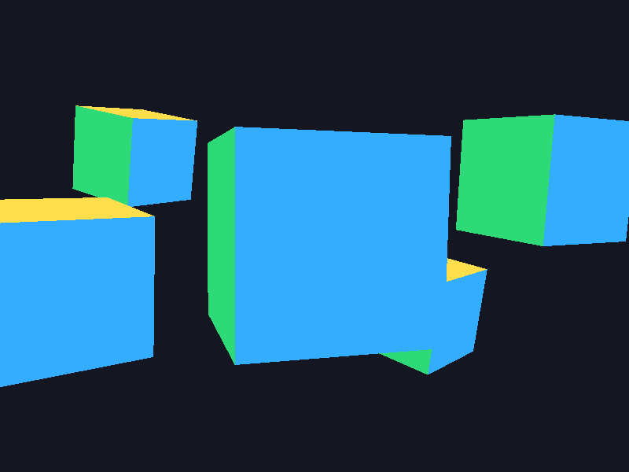
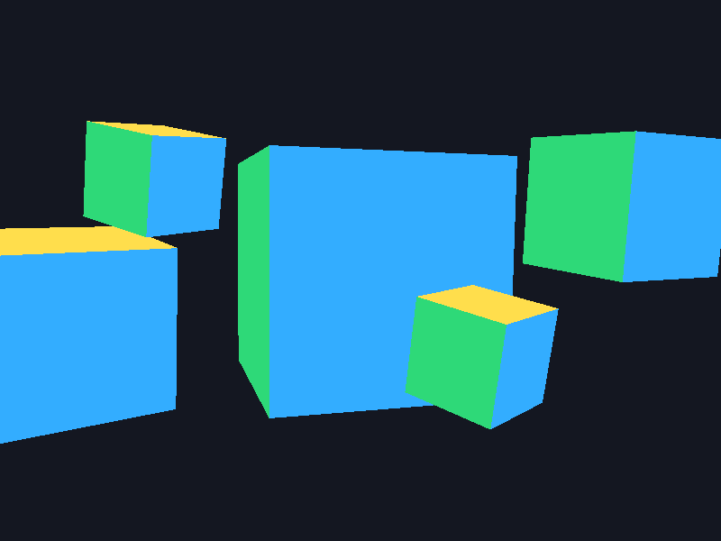
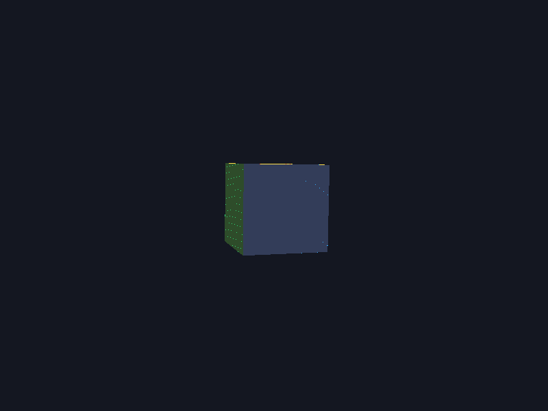
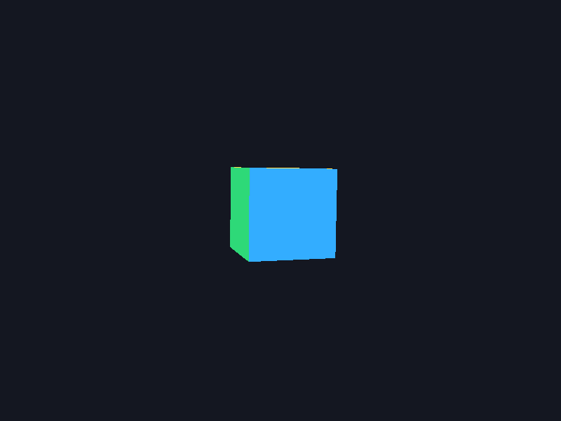

# 8-апта. Тереңдік буфері, culling және Z-fighting

`week08.exe` файлын іске қос. Бастапқы сахнада бес куб әртүрлі жылдамдықпен айналады.

- **1** — бес куб. **D** — тереңдік тестін қосу немесе өшіру. Тест өшірулі кезде қабаттасқан пиксельдерде соңғы сызылған бет үстіне шығады. Сондықтан сызу ретін өзгерту нәтижеге әсер етеді. Тест қосылғанда жақын фрагмент алда қалады.
- **2** — Z-fighting. Кубтардың Z координаттарының айырмасы 0.001, near = 0.0001, far = 1000. Тереңдік мәндерінің дәлдігі жетпегенде беттерде дақтар пайда болады.
- **3** — сол кубтар, near = 0.1 және far = 100. Беттер дұрыс ретпен көрінеді. far мәнін ғана қысқарту әсері аз, себебі дәлдіктің үлестірілуіне near көбірек әсер етеді.
- **C** — GL_BACK пен GL_FRONT ауысады. Алдыңғы беттерді алып тастағанда артқы беттер көрінеді. Көрінетін қырлар саны бұрылу бұрышына байланысты. Үш қыр көрінетін сәтте бір кубтың 12 үшбұрышының алтауы алынып тасталады. OpenGL бет бағытын әр кадрдағы проекция бойынша анықтайды.
- **Esc** — шығу.

| Depth қосулы | Depth өшірулі |
| --- | --- |
|  |  |

| Z-fighting | Түзетілген |
| --- | --- |
|  |  |

Қайта құрастыру үшін репозиторий түбірінен `cmake -S week08 -B week08/build -G "MinGW Makefiles"` және `cmake --build week08/build` командаларын орында.
